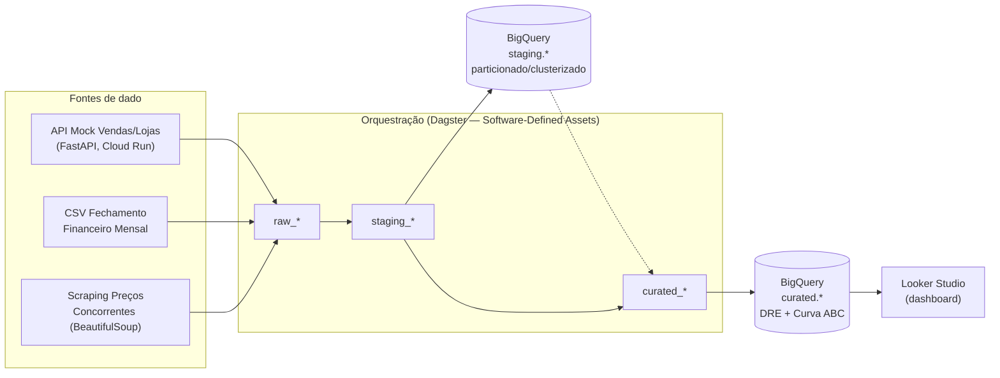

# Painel Multi-Loja — Vena Analytics Sim


Pipeline de dados ponta a ponta — ingestão, orquestração e BI — simulando dois
indicadores de negócio reais de varejo multi-loja: **DRE gerencial** (receita,
despesa, resultado, margem) e **Curva ABC de produtos** (classificação por
faturamento acumulado). Construído para reproduzir, em escala pequena, a
arquitetura e as decisões técnicas típicas de uma posição de Analytics
Engineer Sênior em GCP.

> **Dados 100% sintéticos.** Nenhuma informação de empregador real, atual ou
> anterior, foi usada neste projeto — lojas, produtos, vendas e preços de
> concorrentes são todos gerados/mockados. Ver `docs/uso-ia.md` para o
> histórico de uso de IA generativa na construção do projeto.

## Por que esse projeto existe

Simular, com disciplina de produção (testes, checks de qualidade,
particionamento, controle de custo, segurança), o fluxo que uma squad de
dados de varejo roda de verdade: múltiplas fontes heterogêneas (API, CSV,
scraping) → padronização → regra de negócio → BI — com cada decisão de
arquitetura justificada, não só implementada.

## Arquitetura



Caminho secundário de ingestão orientado a evento (não no diagrama principal,
documentado em `src/functions/`): uma Cloud Function Gen2, disparada por
Eventarc quando um arquivo novo chega no Cloud Storage, valida o conteúdo
antes de mover pra uma pasta `validado/` ou `rejeitado/` — demonstra o padrão
de ingestão orientada a evento, independente do fluxo principal acima (que
roda por schedule).

## Stack e por que cada escolha

| Decisão | Alternativa óbvia | Por que essa, não a outra |
|---|---|---|
| **Dagster** pra orquestração | Airflow | Modelo de Software-Defined Assets: cada função declara o *dado* que produz, não só o passo. Isso dá lineage automático (o grafo de dependência vem dos parâmetros das funções) e testabilidade real — cada asset roda isolado com `build_asset_context()`, sem precisar subir o scheduler inteiro. Airflow tem mais maturidade de mercado e mais operadores prontos; a troca é testabilidade/clareza por ecossistema maior. |
| **BigQuery particionado + clusterizado** | Tabela simples | Toda query do projeto filtra ou agrupa por loja/data. Sem partição, o BigQuery varre a tabela inteira a cada consulta — você paga por byte lido. Particionar por data + clusterizar por `loja_id` corta drasticamente o volume lido nas consultas mais comuns, sem mudar uma linha de SQL de quem consome. |
| **WRITE_TRUNCATE**, não WRITE_APPEND | Append incremental | A fonte (API/CSV/scraping) devolve o estado completo a cada chamada, não um delta. Com APPEND, materializar o pipeline mais de uma vez duplica os mesmos dados — foi exatamente isso que, durante o desenvolvimento, inflou o DRE em 4x sem nenhum erro visível (bug documentado em `bugs/registry.md`). TRUNCATE garante idempotência: rodar 1x ou 10x dá o mesmo resultado. |
| **`Decimal` antes de gravar colunas `NUMERIC`** | `float64` direto | BigQuery `NUMERIC` é `decimal128` no formato Arrow. `float64` do pandas não converte direto pro tipo decimal (erro `ArrowInvalid: Got bytestring of length 8, expected 16`) — silencioso até a hora da carga. Resolver na origem (converter pra `Decimal` do Python antes do `load_table_from_dataframe`) evita o erro em vez de mascará-lo. |
| **Cloud Run** pro mock API (não só Cloud Function) | Manter só local/Function | Cloud Function Gen2 roda, por baixo, em cima do Cloud Run — ou seja, Function é a camada mais simples sobre a mesma infraestrutura. Expor o mock API como serviço Cloud Run de verdade (`gcloud run deploy --source .`) prova deploy real na nuvem, não só teoria, e também elimina a dependência de "meu laptop estar ligado" pro pipeline funcionar. |
| **`requests` + `BeautifulSoup`** pro scraping | Playwright/headless browser | O alvo (catálogo HTML estático) não depende de JavaScript pra renderizar preço — não há necessidade de simular um navegador completo, que é mais lento e mais pesado em recurso. A lógica de parsing fica isolada numa função pura (`_parse_catalogo_html`), testável sem precisar de rede — ver `tests/test_scraping.py`. Pra um alvo real que renderiza via JS, a troca certa seria Playwright, não reescrever o parser. |
| **`in_process_executor`** no job Dagster local | `multiprocess_executor` (padrão) | No Windows, o executor padrão usa `spawn` e reimporta o código do zero em cada subprocesso — com múltiplos steps de I/O de rede em paralelo, é comum um subprocesso crashar silenciosamente ao inicializar libs nativas (`grpc`/`google-api-core`) ao mesmo tempo (bug real encontrado e documentado durante o desenvolvimento). Rodar sequencial, no mesmo processo, troca paralelismo (irrelevante numa pipeline de 8 assets pequenos) por confiabilidade — decisão de engenharia, não limitação. |
| **Service Account dedicada por impersonation** | Chave JSON embutida | Least privilege: a SA só tem as permissões que o pipeline de fato usa (GCS, BigQuery, Eventarc, Cloud Run), nunca uma chave estática salva em disco ou em secret — reduz a superfície de ataque se algo vazar. |
| **CI só com testes, sem deploy automático** | Deploy automatizado via secret de SA key | Uma chave de Service Account como secret do GitHub é prática desencorajada em 2026 (Workload Identity Federation, sem chave armazenada, é o padrão atual). Implementar WIF corretamente é esforço alto pra pouco ganho nesse estágio do projeto — documentado como próximo passo em vez de publicar um pipeline de deploy pela metade. |

## Camadas de dado (raw → staging → curated)

- **raw**: dado bruto, sem nenhuma transformação — snapshot exato do que a fonte devolveu.
- **staging**: schema padronizado e tipado (`src/sql/schema_staging.sql`), sem regra de negócio. Uma tabela por fonte heterogênea (API, CSV, scraping), mesmo formato de saída.
- **curated**: regra de negócio aplicada — DRE gerencial e Curva ABC. É o que o BI consome; ninguém fora da engenharia consulta staging diretamente.

Cada tabela do BigQuery tem `OPTIONS(description=...)` em nível de coluna
(governança de dado — qualquer pessoa explorando o schema no Console entende
o que cada campo significa sem perguntar).

## Dashboard (Looker Studio)

[📊 Ver dashboard exportado (PDF)](docs/Projeto_Vena.pdf)

Painel conectado direto em `curated.dre_gerencial`, consumindo o resultado final do
pipeline — nenhum número é digitado manualmente, tudo vem de consulta ao vivo no
BigQuery.

## Como rodar localmente

```powershell
# 1. Ambiente
.\.venv\Scripts\Activate.ps1
docker compose up -d                 # Postgres local

# 2. Fontes mock (2 terminais separados, ficam rodando)
uvicorn src.mock_api.main:app --reload --port 8000
uvicorn src.scraping.mock_concorrente_site:app --reload --port 8001

# 3. Pipeline
dagster job execute -f src\dagster_project\definitions.py -j pipeline_painel_multi_loja
```

## Testes e qualidade de dado

Duas camadas complementares, propositalmente separadas:

- **`pytest`** (`tests/`) — roda no CI, contra dado sintético controlado, valida que a *lógica* está certa (ex: classificação ABC, parsing de preço).
- **Dagster `asset_check`** (`src/dagster_project/checks.py`) — roda dentro do próprio pipeline, contra o *dado real* que acabou de ser gerado, valida que a *execução* daquele dia não trouxe lixo (API fora do ar, CSV com valor negativo, scraping trazendo preço zerado).

```powershell
pytest -v
```

## CI/CD

GitHub Actions (`.github/workflows/ci.yml`) roda `pytest` a cada push/PR na
`main`. Deploy automático fica fora de propósito por enquanto — ver tabela de
decisões acima.

## Segurança e governança

- Least-privilege IAM via Service Account dedicada (impersonation, sem chave estática).
- Lifecycle policy no Cloud Storage (`infra/gcs_lifecycle.json`): objetos migram pra NEARLINE aos 30 dias, são removidos aos 90 — custo de storage não cresce indefinidamente.
- Colunas documentadas (`OPTIONS(description=...)`) em todas as tabelas BigQuery.
- Nenhum dado real de empregador, atual ou anterior, em nenhum commit deste repositório.

## Próximos passos (documentados, não implementados)

Itens conscientemente deixados de fora nesta fase, com a razão de cada um:

- **Workload Identity Federation** no CI/CD — deploy automatizado sem chave de Service Account armazenada. Esforço alto, ganho baixo nesse estágio do projeto.
- **Sensor Pub/Sub real** — hoje o pipeline dispara por `schedule` (cron diário); a evolução natural é um sensor do Dagster escutando o tópico Pub/Sub que o Eventarc já usa por baixo, disparando o job no momento em que o arquivo chega, não num horário fixo.
- **Cloud Run para o site de scraping mock** — hoje só local; replicar o mesmo deploy do mock API.

## Estrutura do projeto

```
vena-analytics-sim/
├── src/
│   ├── mock_api/            # API FastAPI (vendas/lojas) — deploy no Cloud Run
│   ├── scraping/             # Site mock de concorrente + scraper (BeautifulSoup)
│   ├── dagster_project/      # Assets, checks e definitions (orquestração)
│   ├── functions/            # Cloud Function Gen2 (validação orientada a evento)
│   ├── ingestion/             # Upload pra Cloud Storage
│   └── sql/                   # DDL staging + queries curated
├── tests/                     # pytest
├── infra/                     # Políticas de infraestrutura (lifecycle GCS)
├── docs/                      # uso-ia.md e documentação complementar
├── bugs/registry.md           # Registro de bugs reais encontrados e corrigidos
└── .github/workflows/ci.yml   # CI (testes a cada push)


